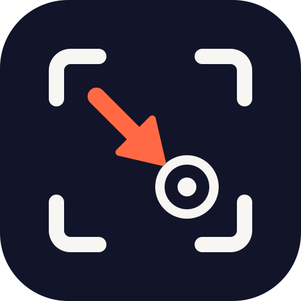
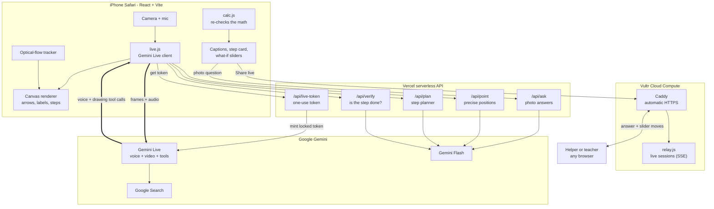

<p align="center">
  
</p>

<h1 align="center">Show Me</h1>

<p align="center">
  <strong>Other AI assistants tell you. This one <em>shows</em> you, and stays with you while you do it.</strong>
</p>

<p align="center">
  <a href="https://whack-ai.vercel.app"><strong>Try it on your iPhone →</strong> whack-ai.vercel.app</a><br>
  Built in 24 hours at <strong>WHACK 2026</strong> (Wellesley College) · Track: <em>Beyond Reality</em> · Also: <em>Better Worlds</em>
</p>

---

Point your phone at something and ask a question out loud. Show Me answers in a natural voice **and draws the answer on the live camera view, on the real object**: arrows, labels, highlight circles, twist arrows and numbered steps. It runs in iPhone Safari, with nothing to install.

- **It draws while it talks:** it gestures at each part as it says "this" or "here". Drawings stay attached to the object as you move the phone.
- **It guides you step by step, and watches you work:** one step at a time, each with a clear "done when" and a reminder of what to hold steady. It checks your progress hands-free and tells you when a step is really done (an independent check makes sure it isn't faking it).
- **Put the phone down and keep going:** lay the phone flat to use both hands. The mic stays on, and when you pick it up it re-finds its drawings and tells you how the step looks.
- **Math you can trust:** for physics questions ("how hard can I push before it tips?") the AI shows its working, our code **re-computes every step** (✓ / ⚠), and **"what if" sliders** let you change any value and watch the verdict update.
- **Share live:** one tap creates a link. A teacher or remote helper sees the same annotated answer, and the sliders **sync both ways in real time**. The camera image never leaves the phone.

## Accessibility

Accessibility was the spec from the first commit, not an add-on.

| Who it helps | How |
|---|---|
| English learners, people with learning disabilities | The answer is **drawn on the real thing**: no vocabulary, reading level or spatial reasoning needed |
| People with ADHD or cognitive disabilities | **One step at a time** with a concrete "done when", and confirmation you actually did it |
| Deaf and hard-of-hearing users | **Live captions** for everything spoken; every answer also exists as text |
| Screen reader users | Finished sentences are announced once (not word by word); every control is labelled |
| People with motor impairments, or busy hands | **Hands-free** progress checks, tap-to-keep-the-mic-open, put the phone down and keep talking, typing as an alternative to speech |
| Low vision | Large, bold, high-contrast labels with dark outlines; drawings and text can be hidden independently |
| Motion-sensitive users | Nothing flashes; calm animations that stop entirely with iOS **Reduce Motion** |
| Everyone | Tap targets ≥ 44×44 px · frames sent only when you ask, never stored · the API key never reaches the phone |

## Architecture



**How a live answer flows:**
1. **Token:** the phone asks our server for a **one-use, locked-config token**, so it can stream straight to Gemini Live without ever seeing the API key.
2. **Talk and draw:** Gemini Live hears you, sees ~1 frame/s, talks back, and **draws through function calls** (`show`, `gesture`, `procedure`, `calc`, `plan`, `wait`).
3. **Snap to the real part:** each new drawing is snapped onto the right spot by a second Gemini Flash call on the *same* frame (`/api/point`). Our tracker then keeps it attached as the phone moves.
4. **Check the math:** `calc` sheets are re-computed by our own code. Nothing numeric reaches the user without a ✓ or ⚠.
5. **Check progress:** while you work on a step, the app runs silent auto-checks (the model calls a `wait` tool we deliberately never answer). Any step change must pass an **independent yes/no check** on a fresh frame (`/api/verify`).

**Share live** runs on our own **Vultr** server: a zero-dependency Node.js relay behind Caddy (Let's Encrypt HTTPS), streaming over **Server-Sent Events**. Only the answer, drawings and slider values pass through it, never camera images. Sessions live in memory and expire.

## Repository layout

| Path | What's there |
|---|---|
| `src/ui/` | Screens: start, camera / photo mode, live mode, shared view, what-if sliders |
| `src/overlay/` | Canvas renderer, scene building, collision-free label placement, smoothing |
| `src/camera/`, `src/orientation/` | Camera access, frame capture, iOS motion permissions |
| `src/client/` | Gemini Live session, tool handling, hands-free watching, phone-down detection, share sessions |
| `src/tracking/` | Optical-flow tracker that keeps drawings on the real spots |
| `src/physics/` | The math checker: expression parser, `evaluateCalc`, number auditing |
| `api/` | Vercel serverless functions (Gemini calls stay server-side) |
| `server/` | Session relay for Share live, plus one-command Vultr deploy (`server/deploy/`) |
| `lab/` | Live Lab: a debugging page for live mode, with debug reports |
| `CONTRACT.md` | The JSON contract between the model, the server and the renderer |

## Run it yourself

```bash
npm install
npm test           # 77 tests: math checker, renderer, tracker, live tools, relay
npm run dev        # UI on http://localhost:5173 (camera needs HTTPS on a phone)
```

**Try the UI without a camera or API key:**
- `?fixture=chair&nocam=1`: a canned photo answer with checked math and sliders.
- `?fakelive=1&nocam=1&fakestep=1`: a scripted live session (talking, gestures, hands-free steps).

**With Gemini:** put `GEMINI_API_KEY=...` in `.env.local` and run the API too, e.g. `npx vercel dev`. To test a prompt from the terminal:

```bash
node --env-file=.env.local api/_dev/try.mjs photo.jpg "Why isn't it falling?"
```

| Environment variable | Where | Purpose |
|---|---|---|
| `GEMINI_API_KEY` | server only | Gemini access. **Never** prefix it with `VITE_`. |
| `VITE_SESSION_URL` | client (public) | Share live relay URL, e.g. `https://<ip-with-dashes>.sslip.io` |
| `GEMINI_MODEL`, `GEMINI_LIVE_MODEL`, `GEMINI_POINT_MODEL`, `GEMINI_PLAN_MODEL`, `GEMINI_VERIFY_MODEL` | server | Optional model overrides |

**Deploy the Share live relay on Vultr:** use any Ubuntu 24.04 server, no domain needed.

```bash
scp server/relay.js server/deploy/* root@IP:/root/relay-setup/
ssh root@IP 'bash /root/relay-setup/setup.sh <ip-with-dashes>.sslip.io "*"'
```

## Built with

Gemini Live API · Gemini Flash · Google Search grounding · Vultr Cloud Compute · Caddy · Node.js · Server-Sent Events · React · Vite · HTML5 Canvas · Web Audio · getUserMedia · DeviceMotion / DeviceOrientation · Vercel

## Team

Built at WHACK 2026 by [Austin Stanley Hinson](https://github.com/austin-stanley-hinson) (client, renderer and accessibility) and [Josh](https://github.com/jdyar) (server, Gemini, tracking and math), each pair-programming with an AI coding agent. A shared JSON contract (`CONTRACT.md`) and strict file ownership (`CLAUDE.md`) kept the two lanes, and the agents, from overwriting each other's work.
